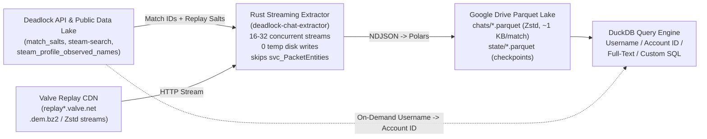

# Deadlock All-Chat

[](https://colab.research.google.com/github/veroiuxl/deadlock-all-chat/blob/main/notebooks/deadlock_all_chat_colab.ipynb)

High-throughput collector and username query engine for **Deadlock** in-game replay chat messages (both **All-Chat** and **Team-Chat**), engineered specifically for **Google Colab** and backed by the [Deadlock API](https://api.deadlock-api.com/) and its public [Parquet Data Lake](https://deadlock-api.com/data-dumps).

## Architecture



## Why This Processing Strategy Is Best for Google Colab

We evaluated three approaches on real Deadlock replays and built the fastest one into a Colab-friendly pipeline:

| Approach | Raw `.dem` Parse (52 MB) | Compressed `.dem.bz2` End-to-End | Temp Disk Per Replay | Colab Suitability |
| :--- | ---: | ---: | ---: | :--- |
| **Custom Rust Streaming Parser (`deadlock-chat-extractor`)** | **42 ms** | **182 ms** | **0 MB** | **Best** — 30× faster CPU, zero disk writes, 16–32 concurrent HTTP streams |
| [`boon-deadlock`](https://pypi.org/project/boon-deadlock/) (Python/Rust full parser) | 1,304 ms | 1,392 ms | 50–450 MB | Good zero-compile fallback (included in `extractor.py`) |
| Deadlock API `POST /v1/matches/demo/query` | — | ~13,000 ms (server-side) | 0 MB | Ad-hoc single match only (rate-limited queue) |

### Key Technical Findings That Drive the Design

1. **Zero-Entity-Decoding Source 2 Parsing (30× CPU speedup):**
   ~98% of bytes in a Deadlock `.dem` file are `svc_PacketEntities` entity delta updates. Chat messages live in `CCitadelUserMsg_ChatMsg` (message ID `314`), player identities (`name`, `steamid`, `account_id`) live in the `userinfo` string table (`DEM_StringTables` / `DEM_FullPacket`), and match metadata (`match_id`, `start_time`, `duration_s`, `hero_id`, `team`) lives in `CCitadelUserMsg_PostMatchDetails` (ID `316`). Skipping all other messages in `O(1)` inside `CDemoPacket` cuts CPU time from ~1.3s to **~42 ms** while maintaining **100% parity** with `boon-deadlock`.
2. **Magic-Byte Decompression (Zstd disguised as `.dem.bz2`):**
   Even though Valve replay URLs still end in `.dem.bz2`, newer Deadlock replays are actually **Zstandard** compressed (`28 B5 2F FD`, decompressing at >300 MB/s), while older replays use **Bzip2** (`BZh`). Our streaming decompressor sniffs magic bytes automatically and pipes HTTP chunks directly into the parser with **zero uncompressed `.dem` disk writes**.
3. **Colab Runtime & Storage Math:**
   - **Use a standard CPU runtime** (no GPU needed — workload is network I/O + Zstd/Snappy CPU).
   - Deadlock produces ~240k–300k matches/day with `replay_salt` in `match_salts` (average ~50 MB compressed per replay; Valve retains replays on its CDN for **~14–21 days**).
   - Extracted chat data compresses to **~0.6–2 KB per match** in Zstd Parquet (**~70,000× smaller** than the source replays — 1,000,000 matches fit in ~1–2 GB on Google Drive).
   - The Rust binary compiles once (~1–2 min) and caches itself to Google Drive (`bin/deadlock-chat-extractor`) so future Colab sessions boot in ~5 seconds.
   - Checkpoints flush to `state/*.parquet` after every chunk so Colab disconnects never cause duplicate downloads.
4. **Hybrid Collection + On-Demand Username Query:**
   - **Bulk Mode:** Continuously harvests matches from Deadlock API's public `match_salts` Parquet lake via DuckDB HTTP range queries.
   - **Username Lookup Mode:** Queries your local Parquet lake by username **and** resolves the player's Steam `account_id` via Deadlock API (`/v1/players/steam-search` + optional historical `steam_profile_observed_names`), optionally live-fetching & parsing any of their uncached recent replays in seconds and saving all players' messages back into the lake.

## Quickstart in Google Colab

1. Open [`notebooks/deadlock_all_chat_colab.ipynb`](notebooks/deadlock_all_chat_colab.ipynb) in Google Colab (Runtime → **CPU**).
2. Run **Cell 1** to mount Google Drive, install dependencies, and compile/cache `deadlock-chat-extractor`.
3. Run **Cell 2** to bulk-harvest recent matches into your Drive Parquet lake (resumable across sessions).
4. Run **Cell 3** to query any Steam username (with optional on-demand live fetching of their recent matches).

## Local CLI Usage

```bash
# 1. Install Python package
pip install -e .

# 2. Build the Rust streaming extractor (requires Rust/Cargo)
deadlock-chat build

# 3. Bulk-harvest 200 recent matches into ./data
deadlock-chat --data-dir ./data harvest --matches 200 --chunk-size 50 --concurrency 16

# 4. Query all chat messages typed by a username (with live fetch of uncached recent games)
deadlock-chat --data-dir ./data lookup "SomeUsername"

# 5. Query local Parquet lake only (no network requests)
deadlock-chat --data-dir ./data lookup "SomeUsername" --no-live-fetch

# 6. Full-text search across all collected messages
deadlock-chat --data-dir ./data search "mid boss"

# 7. View corpus statistics & compact Parquet shards
deadlock-chat --data-dir ./data stats
deadlock-chat --data-dir ./data compact
```

## Parquet Schema (`chats/*.parquet`)

| Column | Type | Description |
| :--- | :--- | :--- |
| `match_id` | `UInt64` | Deadlock match ID |
| `start_time` | `Int64` | Match start UNIX timestamp (UTC seconds) |
| `duration_s` | `UInt32` | Match duration in seconds |
| `game_mode` / `match_mode` | `UInt32` | Deadlock game/match mode enum |
| `tick` | `Int32` | Source 2 demo tick when message was sent |
| `game_time_s` | `Float32` | In-game timestamp in seconds (`tick * tick_interval`) |
| `player_slot` | `Int32` | 0-based `userinfo` slot index |
| `account_id` | `UInt32` | SteamID3 (`steam_id - 76561197960265728`) |
| `steam_id` | `UInt64` | SteamID64 |
| `player_name` | `Utf8` | In-game username used during that match |
| `hero_id` | `UInt32` | Hero ID from `PostMatchDetails` |
| `team` | `UInt8` | Lobby team (`0` = Team 0 / Amber, `1` = Team 1 / Sapphire) |
| `chat_type` | `Utf8` | `"all"` or `"team"` |
| `text` | `Utf8` | Chat message content |

## Running Tests

```bash
pip install -e ".[dev]"
pytest -v
```
